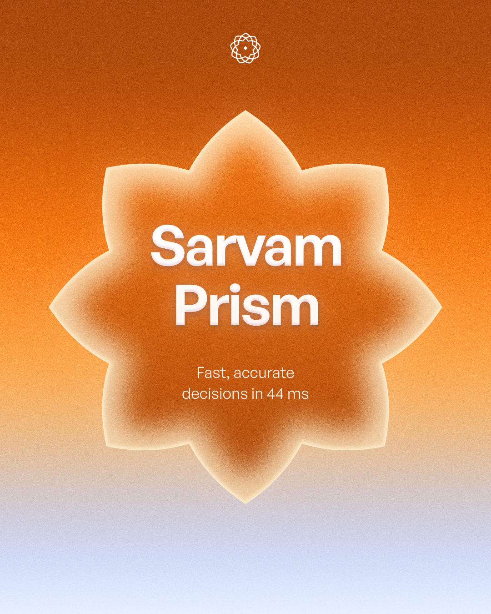
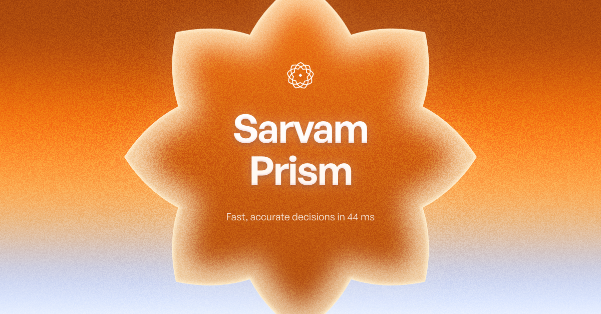
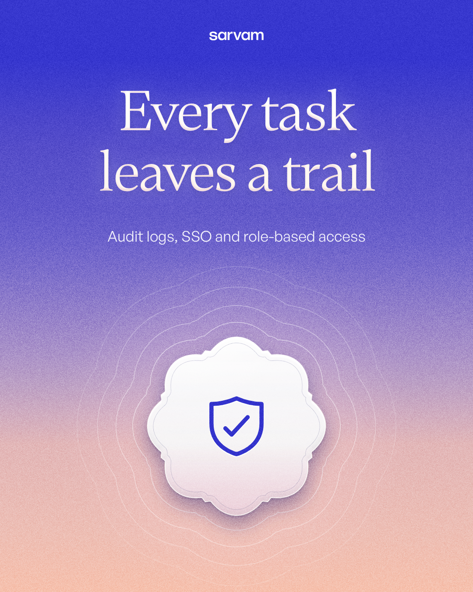
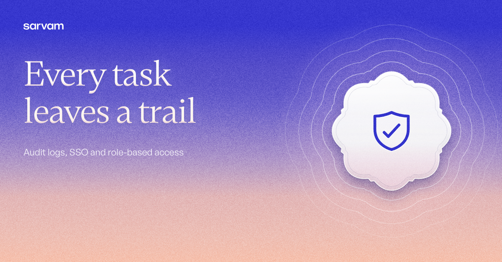
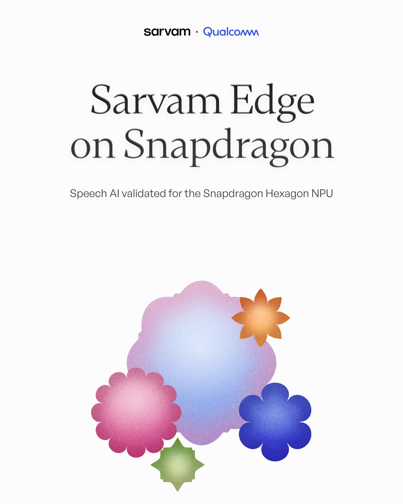
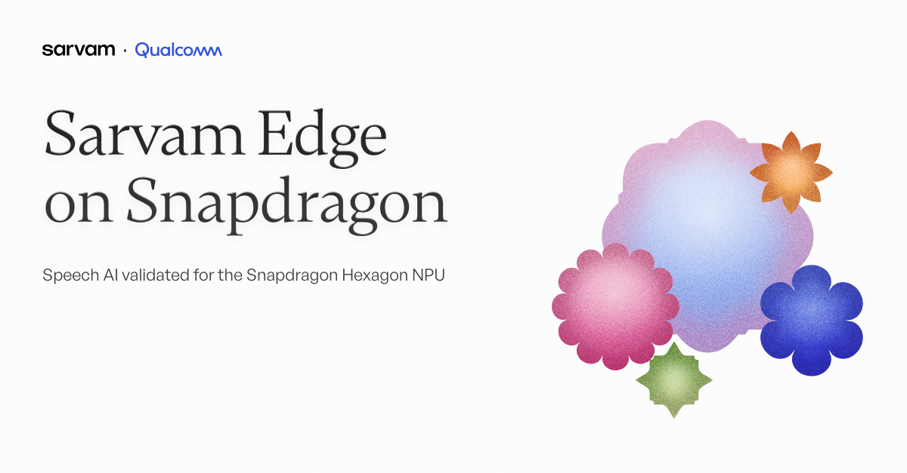

# Sarvam AI · Design Engineer Internship take-home

**Malay Patel** · A design system built on Sarvam's existing brand, and everything generated from it.

**Submission page → https://sarvam-ai-internship-assignment-4of.vercel.app/submission** · Live page → https://sarvam-ai-internship-assignment-4of.vercel.app/

The brand system is the main deliverable. I captured Sarvam's brand as explicit tokens, rules and recipes written for AI, then used AI to generate the banners and the page from it, while I directed, rejected and refined. Every correction became a rule. The banners and the page are the proof that the system works.

## Deliverables
Everything is in **[`deliverables/`](deliverables)**, numbered to match the brief.

| # | Deliverable | Folder |
|---|---|---|
| 1 | **Brand & design system** (packaged as a skill) | [`deliverables/1-design-system/`](deliverables/1-design-system): start at [`SKILL.md`](deliverables/1-design-system/SKILL.md) · visual review [/system](https://sarvam-ai-internship-assignment-4of.vercel.app/system) |
| 2 | **3 Meta banners** (1080×1350) | [`deliverables/2-meta-banners/`](deliverables/2-meta-banners) · gallery [/banners](https://sarvam-ai-internship-assignment-4of.vercel.app/banners) |
| 3 | **3 LinkedIn banners** (1200×627) | [`deliverables/3-linkedin-banners/`](deliverables/3-linkedin-banners) |
| 4 | **Responsive web page**: Indus Cowork | **[Live](https://sarvam-ai-internship-assignment-4of.vercel.app/)** · [`deliverables/4-web-page/`](deliverables/4-web-page) (exports at 375 / 768 / 1440) |
| 5 | **Source files** | this repo · map in [`deliverables/5-source/`](deliverables/5-source) |
| 6 | **Write-up**: process, tools, key prompts, testing | [`deliverables/6-writeup/writeup.md`](deliverables/6-writeup/writeup.md) |

## The banners
Three messages (a model launch, a Cowork capability, a hardware partnership), one per banner. Each banner is rearranged per format, never cropped or stretched.

| Meta 1080×1350 | LinkedIn 1200×627 |
|---|---|
|  |  |
|  |  |
|  |  |

## How the system was tested
- **Before / after:** the same prompt went to a fresh model in an empty folder, once without the system and once with it. Without, it invented a logo, numbers and a wrong CTA; with, the output was on-brand. See [`deliverables/6-writeup/before-after/`](deliverables/6-writeup/before-after).
- **New subjects, same playbook:** two more pages, each with its own theme (structure + hero light), generated from the system:
  - [Bulbul V4 Flash](https://sarvam-ai-internship-assignment-4of.vercel.app/bulbul) · exports [375](deliverables/6-writeup/system-tests/bulbul-375.png) · [768](deliverables/6-writeup/system-tests/bulbul-768.png) · [1440](deliverables/6-writeup/system-tests/bulbul-1440.png)
  - [Document AI](https://sarvam-ai-internship-assignment-4of.vercel.app/document-ai) · exports [375](deliverables/6-writeup/system-tests/document-ai-375.png) · [768](deliverables/6-writeup/system-tests/document-ai-768.png) · [1440](deliverables/6-writeup/system-tests/document-ai-1440.png)
- **Responsive at every width:** every page is checked at 10 widths (320–1920) in Chromium and WebKit for sideways overflow, sibling sizes and line counts, and 44px touch targets.

## Tools
Claude Code (Claude Opus) for research, the system, generation and QA scripts · Playwright for checks and exports · Next.js + Vercel · Nucleo icons · free type stand-ins: Gambetta, General Sans, DM Mono (Sarvam's fonts are commercial; the swap point is one token).

## Run it locally
```bash
npm install
npm run dev                              # http://localhost:3000
node scripts/export-page.mjs             # page exports → deliverables/4-web-page/, 6-writeup/system-tests/
node scripts/check-layout.mjs http://localhost:3000/   # layout QA at 10 widths
```

*Sarvam's own reference images are kept locally as research and aren't republished here. What I took from them is written up in [`references/brand-findings.md`](references/brand-findings.md).*
