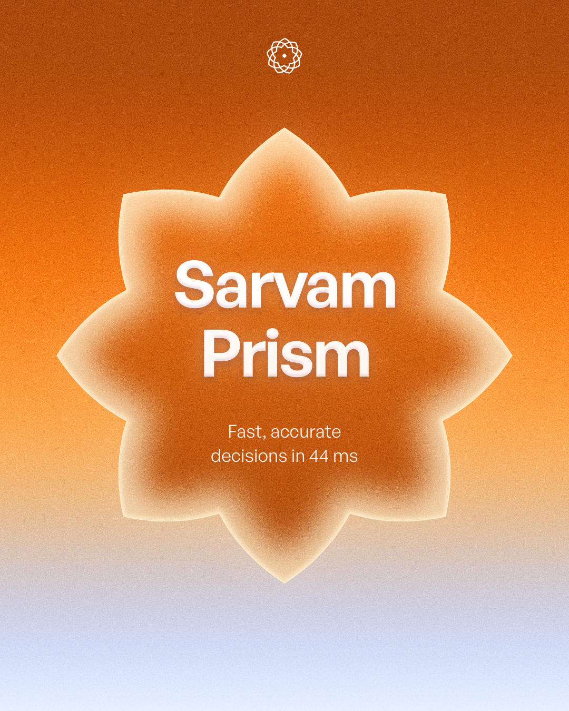
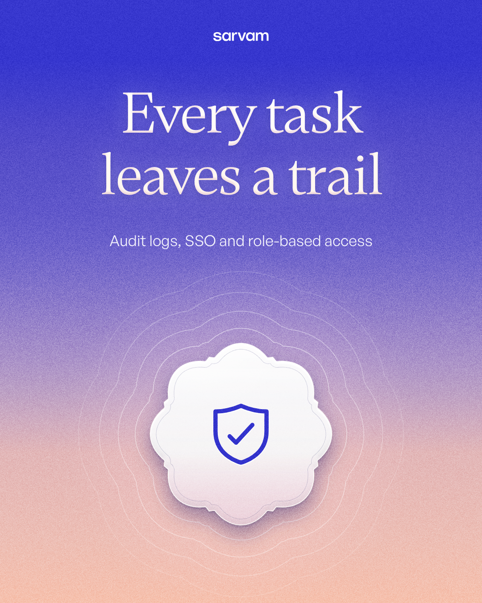
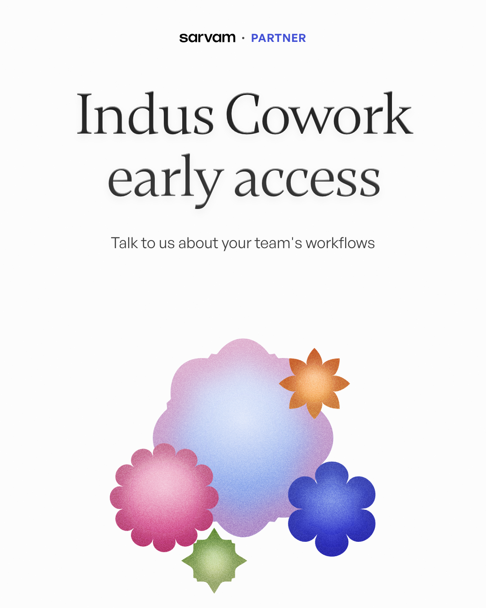

# 3 Meta banners · 1080×1350 (4:5)

One subject family, one message per banner. The same three subjects appear in [`../3-linkedin-banners/`](../3-linkedin-banners), rearranged for that format rather than cropped.

## The set

Three Meta banners (1080×1350) and three LinkedIn banners (1200×627). Each subject comes in both formats, rearranged for that format rather than cropped.

| # | Subject | Meta | LinkedIn | Brief id | Device |
|---|---|---|---|---|---|
| 1 | Sarvam Prism launch | `meta-1-sarvam-prism.png` | `linkedin-1-sarvam-prism.png` | `prism` | medallion-glow · Eight-point star, dawn |
| 2 | Every task leaves a trail (Indus Cowork audit + access) | `meta-2-every-task-leaves-a-trail.png` | `linkedin-2-every-task-leaves-a-trail.png` | `final-trail` | emblem · shield, indigo glow |
| 3 | Indus Cowork early access (partner program) | `meta-3-indus-cowork-early-access.png` | `linkedin-3-indus-cowork-early-access.png` | `final-early-access` | gloss cluster, split layout, `sarvam · PARTNER` |

- **Source:** (in the repo) `banners/briefs.json` (the specs) → `src/components/sarvam/composer.tsx` (the engine).
- **Export:** `node scripts/export-banners.mjs <id>`.
- **QA:** `node scripts/check-banners.mjs set`. All six pass.
- **Placeholder:** "PARTNER" on banner 3 stands for the real partner's name.
