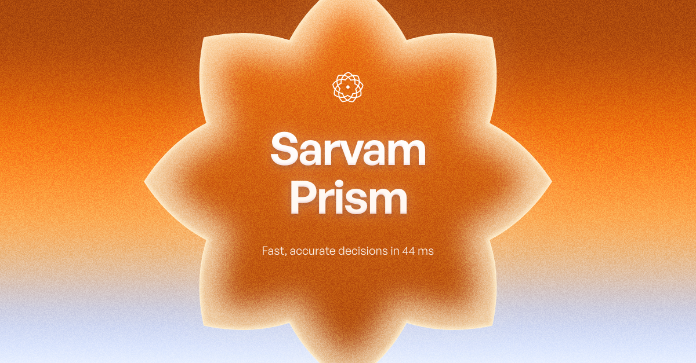
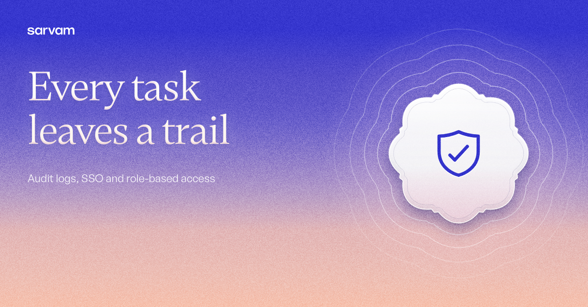
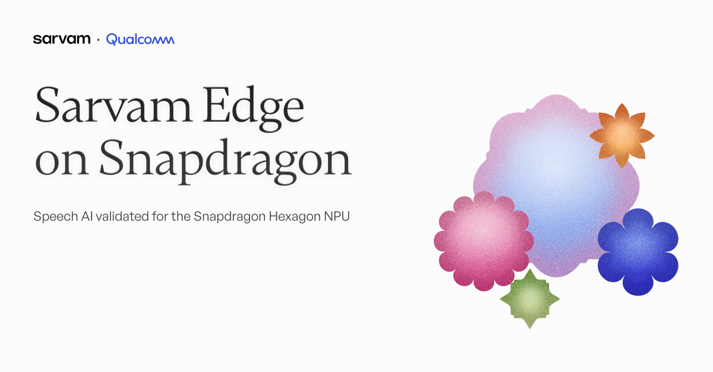

# 3 LinkedIn banners · 1200×627

Three messages, one per banner. The same three subjects appear in [`../2-meta-banners/`](../2-meta-banners), rearranged for that format rather than cropped.

## The set

Three Meta banners (1080×1350) and three LinkedIn banners (1200×627). Each subject comes in both formats, rearranged for that format rather than cropped.

| # | Subject | Meta | LinkedIn | Brief id | Device |
|---|---|---|---|---|---|
| 1 | Sarvam Prism launch | `meta-1-sarvam-prism.png` | `linkedin-1-sarvam-prism.png` | `prism` | medallion-glow · Eight-point star, dawn |
| 2 | Every task leaves a trail (Indus Cowork audit + access) | `meta-2-every-task-leaves-a-trail.png` | `linkedin-2-every-task-leaves-a-trail.png` | `final-trail` | emblem · shield, indigo glow |
| 3 | Sarvam Edge on Snapdragon (partnership with Qualcomm, as published on sarvam.ai/products/edge) | `meta-3-sarvam-edge-qualcomm.png` | `linkedin-3-sarvam-edge-qualcomm.png` | `final-early-access` | gloss cluster, split layout, `sarvam · Qualcomm` lockup (Qualcomm's official logo) |

- **Source:** (in the repo) `banners/briefs.json` (the specs) → `src/components/sarvam/composer.tsx` (the engine).
- **Export:** `node scripts/export-banners.mjs <id>`.
- **QA:** `node scripts/check-banners.mjs set`. All six pass.
- **Partner lockup:** banner 3 uses Qualcomm's official logo file (`public/brand/partners/qualcomm.svg`). The partnership (Sarvam Edge validated for the Snapdragon Hexagon NPU) is published by Sarvam on sarvam.ai/products/edge.
