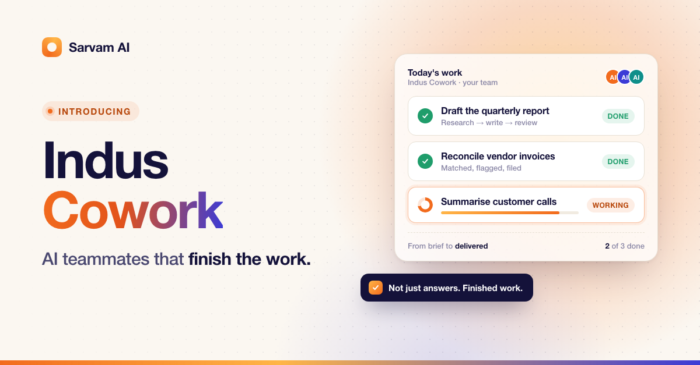
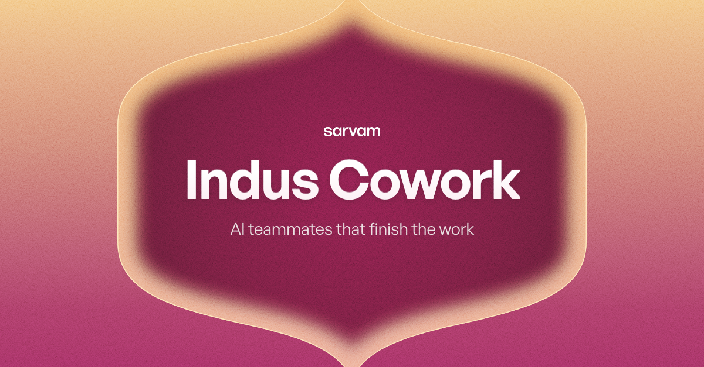
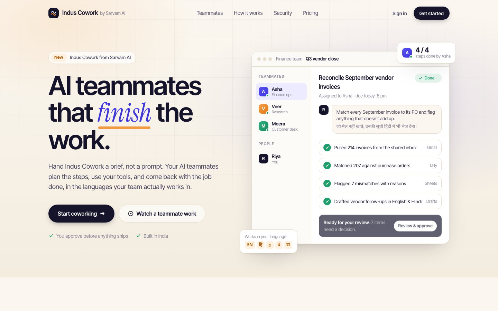
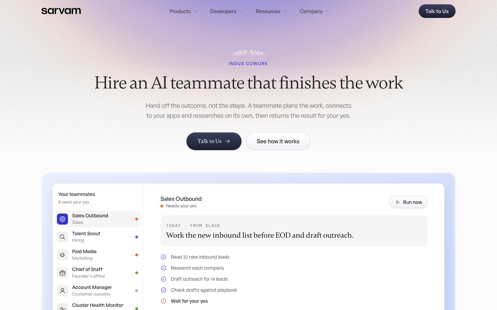
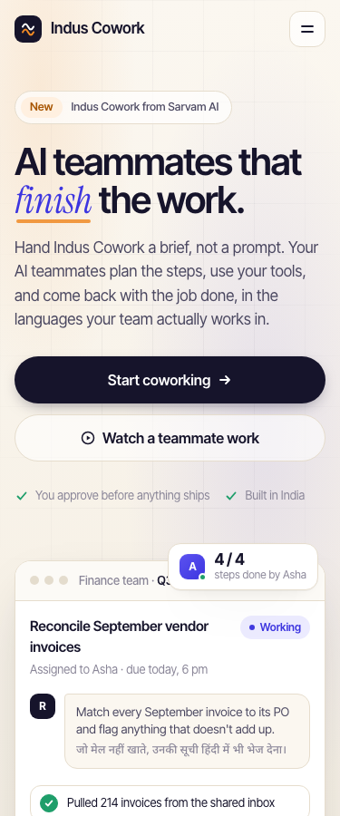
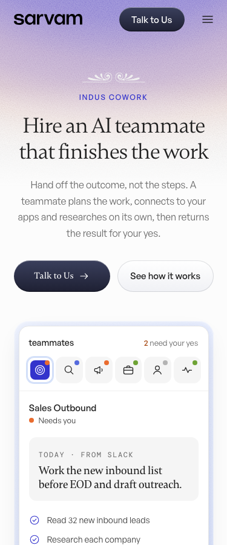

# Before / after: the same prompt, without and with the design system

**Method (2026-11-04).** Four fresh, headless Claude Code runs (`claude -p`), each in an empty folder that had never seen this project. Tools were limited to read and write files.
- **Without:** the prompt alone.
- **With:** the same prompt plus one sentence: "Use the brand design system in ./design-system (start at design-system/SKILL.md) and the official assets in ./brand". The folder held a copy of `/design-system` and the official logo files.

There was no editing and no second attempt. The outputs, logs and prompts are in `source/` and `prompt-*.txt`. Screenshots were taken with Playwright at the stated sizes.

## 1. LinkedIn banner (1200 × 627)

| Without the system | With the system |
|---|---|
|  |  |

**Without:**
- An invented logo ("a placeholder shape", in the run's own words).
- Made-up copy and task data.
- Inter type with a gradient-filled headline.
- A generic SaaS card layout with a dot grid and a rainbow strip.
- A dark caption chip floating off the card.

It's competent, but it could be any startup.

**With:**
- The official white wordmark.
- The gateway (cusped arch) as the one hero device.
- A named campaign gradient with grain.
- Two text slots only (product name + one line), centred in the shape.

That is the "two-text rule", the "one device" rule and the logo rules from `recipes/banner-builder.md` and `logo.md`. It reads as Sarvam.

**Drift:** the gateway's inner glow is a wide, soft blur. That breaks banner hard rule 8 ("Sharp, not soft": inner glow blur ≤ 3.5% of the shape). The sans headline is allowed (rule 7 has sans and serif steps).

## 2. Landing-page hero (1440 and 375)

| Without the system | With the system |
|---|---|
|  |  |
|  |  |

**Without:**
- An invented "Indus Cowork by Sarvam AI" logo.
- A "Pricing" link and a "Get started" / "Start coworking" CTA, although the product isn't generally available.
- Invented numbers (214 invoices, 207 matched) and named fake people.
- A heavy grotesk headline with an italic flourish.

**With:**
- Sarvam's real nav (Products / Developers / Resources / Company) with one CTA, "Talk to Us" (correct: not generally available).
- The kicker, H1 and lead from the voice fact sheet.
- The display serif.
- The indigo-glow hero light with grain.
- The product dashboard full-width under centred text, as the landing-page playbook asks.
- Real teammate roles (Sales Outbound, Talent Scout …).

**Drift:** none against the rules. The serif primary-button label is the system's own rule (typography.md rule 1). On phones it rearranges rather than shrinks: the teammate list becomes an icon row (layout.md).

## What this shows
- Without the system, a capable model produces polished but generic output and invents facts, logos and CTAs.
- With it, the same model, given only files and no conversation, reproduces the brand's devices, its facts and its rules.
- The one drift was a soft glow on the banner. That rule is in `recipes/banner-builder.md`, but only `check-banners.mjs` enforces it, and a fresh model never runs that script.
- Lesson: rules a script enforces must also be stated where a model reads first. I added rule 8 to `SKILL.md`'s quick rules.
